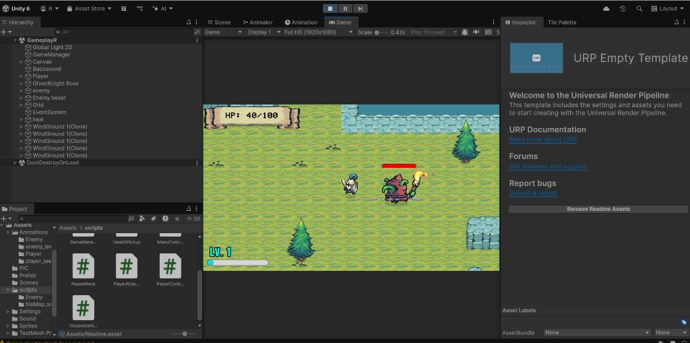

# Holo Knight

Game aksi 2D bergaya pixel art, dibuat di Unity 6 dengan Universal Render Pipeline. Pemain menjelajah lapangan rumput, melawan monster, menaikkan level, lalu menghadapi Ghost Knight sebagai bos.

## Cara bermain

| Tombol | Aksi |
| --- | --- |
| W A S D / panah | Bergerak |
| Shift | Lari |
| Spasi | Dash (kebal sebentar saat dash) |
| Klik kiri | Serang |
| Esc | Jeda |

Darah penuh dimulai di 100. Item penyembuh menambah 20 HP. Mengalahkan musuh memberi XP. Setiap naik level, darah maksimum naik 20 dan damage naik 5.

## Alur permainan

1. **Main Menu** (`MainMenuR`) — mulai permainan, buka pengaturan volume, atau keluar.
2. **Gameplay** (`GameplayR`) — lawan musuh yang berpatroli. HP, level, dan bar XP tampil di layar.
3. **Bos Ghost Knight** — musuh besar dengan darah tinggi, serangan dash, dan musik bos. Mengalahkannya membuka scene kemenangan.
4. **Menang** (`WinR`) — scene akhir setelah bos kalah.
5. Jika darah habis, panel game over muncul. Pemain bisa mengulang scene atau kembali ke menu.

Volume master disimpan lewat `PlayerPrefs`, jadi pengaturan tetap ada setelah game ditutup.

## Dibuat dengan

- Unity `6000.2.2f1`
- Universal Render Pipeline (2D)
- TextMeshPro untuk UI
- C# untuk kontrol pemain, musuh, bos, menu, dan pickup

Skrip utama ada di `Assets/scripts/`.

## Membuka proyek

1. Pasang Unity 6 (`6000.2.2f1`) dengan modul 2D.
2. Buka folder ini lewat Unity Hub.
3. Tunggu impor selesai, lalu buka scene `Assets/Scenes/MainMenuR.unity`.
4. Tekan Play.

Folder `Library`, `Logs`, `Temp`, `obj`, dan `UserSettings` tidak ikut di repositori. Unity membuatnya lagi saat proyek dibuka.
